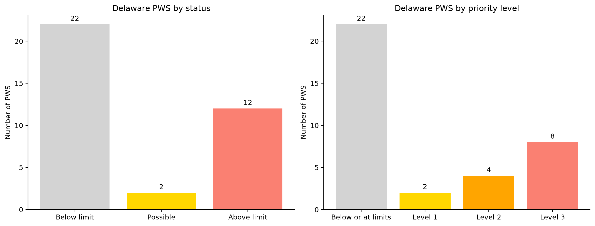
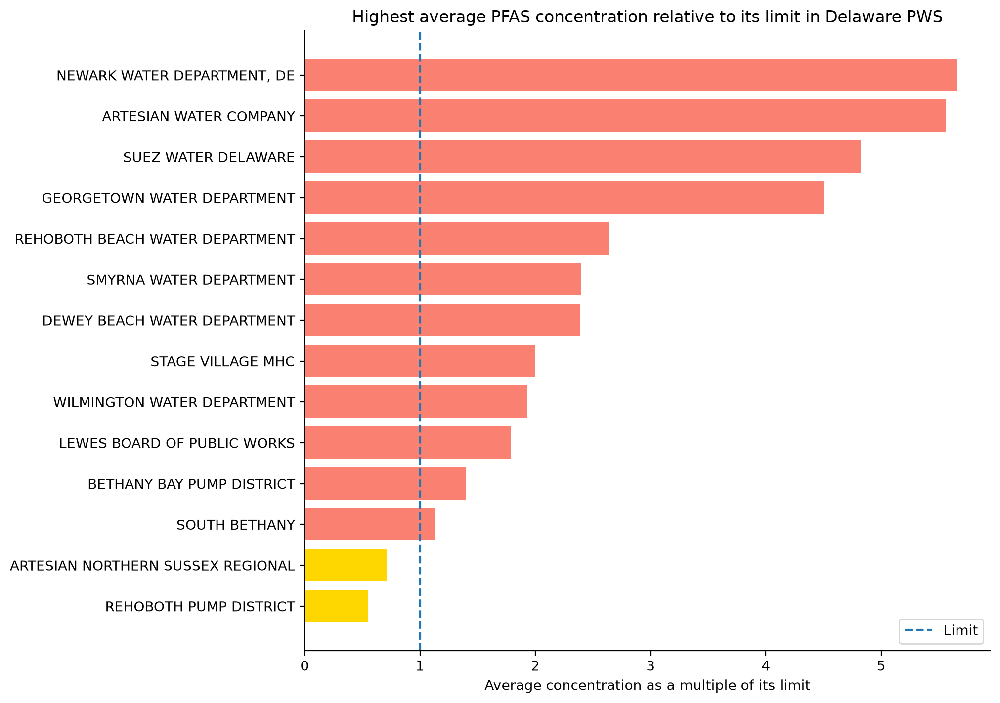
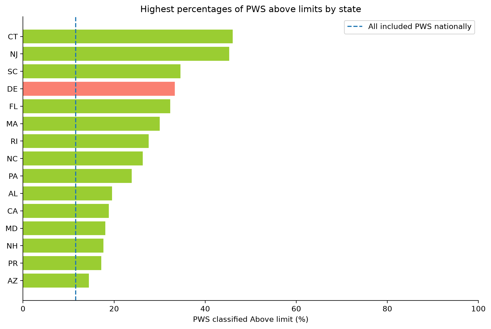

# PFAS in Delaware Public Drinking Water

This project uses EPA's UCMR 5 measurements collected during 2023–2025 to examine **which Delaware public water systems (PWS) had PFAS results above the 2024 federal limits**, and by how much.  
PWS are then grouped into **priority levels** for follow-up investigation and sampling.

A nondetect means a compound was not measured at or above the laboratory's reporting limit. It does not mean the water contained none of that compound. This analysis uses two assumptions for nondetects to show when that uncertainty could change the findings.

The research asks:

1. **Statewide:** How many Delaware PWS had results above a limit, and by how much?
2. **Context:** How do Delaware PWS compare with those in other states and territories?
3. **Priority:** Which PWS should be considered first for follow-up under the chosen criteria?

## Key findings

- **12 of 36 Delaware PWS (33.3%) had at least one compound with an average concentration above its federal limit**, compared with **11.6% of included PWS nationally**. 2 Delaware PWS had uncertain results due to nondetects. The remaining 22 were below or at the limits.
- **8 Delaware PWS had an average concentration at least 2x a compound's limit.** These received the highest follow-up priority, **Level 3**. 4 PWS were above a limit but below twice that limit (**Level 2**), and 2 had uncertain results requiring follow-up sampling (**Level 1**).
- **At one Newark sample point, a compound's average concentration was about 5.7x its limit**, which was the largest multiple found among Delaware PWS.
- **PFOA and PFOS** accounted for most of the above-limit classifications.
- **Delaware had one of the highest percentages of PWS with above-limit results (33.3%) among states with at least 10 PWS included in the analysis.**

Concentrations were averaged separately for each compound at each sample point. Each PWS received its most serious classification. Because these measurements are from 2023–2025, they do not establish current water quality.

## Results

### How many Delaware PWS fall into each status and priority level?

A PWS can have several sample points, each tested for multiple compounds.  
If at any sample point, there's a compound with an average concentration above its limit, the PWS is classified as **Above limit**.  
If nondetects make it uncertain whether an average concentration is above its limit, the PWS is classified as **Possible**.

| Level                  | What it means                                                                                                                        |
| ---------------------- | ------------------------------------------------------------------------------------------------------------------------------------ |
| **Level 3**            | At least one compound's average concentration is 2x the limit or more                                                                |
| **Level 2**            | At least one compound's average is above, but less than twice the limit                                                              |
| **Level 1**            | Nondetects make it uncertain whether a compound's average is above its limit, so follow-up sampling is needed                        |
| **Below or at limits** | Average concentrations stay at or below each compound's limit, even when nondetects are counted as their laboratory reporting limits |

The above-limit averages in Levels 2 and 3 use zero for nondetects, so they remain above a limit even under that assumption.  
(These levels are follow-up categories chosen for this analysis, not official regulatory categories)

### How far above the limits are the results?

**Each bar shows the largest multiple of a compound's limit found for that PWS, using the compound's average at a sample point.** For example, an average of 8 ppt compared with a limit of 4 ppt gives a bar of 2 for twice the limit.  
The dashed line at 1 represents the limit.

For this chart, nondetects contribute zero to the averages. This is why a PWS labeled **Possible** can have a bar below 1: its average could be above the limit if the unknown concentrations below reporting limits were higher. The chart includes both Above limit and Possible PWS.

Each bar compares one compound with its own limit - it does not add different PFAS concentrations together.

### How does Delaware compare nationally?

The chart below compares **the percentage of included PWS with above-limit results** in each state or territory. It shows the 15 highest percentages among those with at least 10 included PWS. The dashed line is the percentage across all PWS in the national analysis, including tribal-region records.

The 10 PWS cutoff avoids displaying percentages based on very small groups.

The [reporting notebook](delaware_pfas_report.ipynb) also shows:

- How often each PFAS compound was detected across Delaware PWS
- A combined measure for 4 PFAS, called the **hazard index**.
- A Zipcode map, where each zipcode receives the highest priority level among its associated PWS  
  (The map does not show the exact service boundaries or household exposure)

## How the analysis works

1. **Load data:** Python reads the EPA files and loads them into PostgreSQL, keeping identifiers as text and converting dates and concentrations to suitable types.
2. **Check data quality:** SQL checks for missing identifiers, duplicate records, unexpected result signs, and reporting-limit differences. Lithium is removed because it is not a PFAS.
3. **Handle nondetects:** Each nondetect is counted as zero for a lower estimate and as its laboratory reporting limit for an upper estimate. Detected concentrations stay the same in both. These are bounding assumptions and not definitive measured concentrations. Concentrations are then converted to ppt.
4. **Average and compare:** For each compound at each sample point, average the available results for both bounds. If the lower average is above the compound's limit, classify it as Above limit. If only the upper average is above, classify it as Possible. Otherwise, classify it as Below limit. An average exactly at a limit is not counted as above it.
5. **Assign status and priority for each PWS:** Use the most serious result from a PWS's sample points and compounds. Assign Levels 1–3 using the criteria above.
6. **Examine 4 PFAS measurements together:** Calculate a separate hazard index for PFHxS, PFNA, HFPO-DA, and PFBS. Each compound's concentration is divided by its reference concentration, then the 4 contributions are added within an event. Only events with all four compounds reported once are used for the sample point averages. Nondetects count as zero. This hazard index is separate from the PWS counts reported above.
7. **Create charts and a map:** The reporting notebook reads the SQL results and presents the findings.

A sampling event is identified using its PWS, facility, sample point, collection date, and event code. To identify a compound result within that event, the compound name is also needed. The collection date by itself does not identify an event.

## Data and tools

- **EPA UCMR 5 occurrence data:** UCMR5_All.txt and UCMR5_ZIPCodes.txt, available from the [EPA occurrence-data page](https://www.epa.gov/dwucmr/occurrence-data-unregulated-contaminant-monitoring-rule#5)
- **Map:** Census 2020 ZIP Code Tabulation Areas (ZCTAs) from the [Cenus Bureau](https://www.census.gov/cgi-bin/geo/shapefiles/index.php?year=2020&layergroup=ZIP%20Code%20Tabulation%20Areas)
- **Tools:** PostgreSQL, Python, pandas, SQLAlchemy, Matplotlib, GeoPandas, and Folium. pgAdmin can be used to run the SQL

## Limitations

- The limits used come from the 2024 federal rule. This project does not verify current regulatory requirements.
- PWS were sampled at different times and with different coverage.
- Nondetects leave some concentrations unknown. Because of this, a hazard index at or below 1 does not mean the true index is at or below 1.
- There are incomplete and repeated-compound events that require review before they can be used in the hazard-index averages.
- Measurements are from 2023–2025 and does not establish current water quality or treatment effectiveness.

## Reproducing the analysis

**Requirements:** PostgreSQL and Python. Install the packages in requirements-notebook.txt.

1. Download the EPA text files and place it in data/raw/
2. Create a PostgreSQL database named pfas_analysis
3. Run load_data.py
4. Run SQL files from 01 to 04 in order, committing the changes
5. Run delaware_pfas_report.ipynb and inspect its results

The notebook saves the chart images in reports/figures/.
